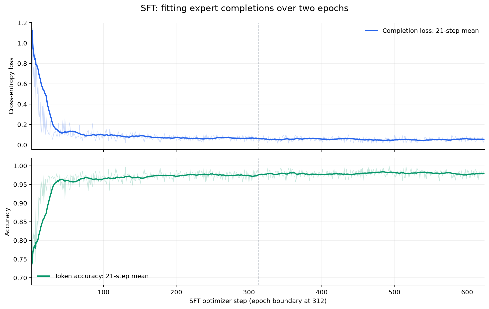
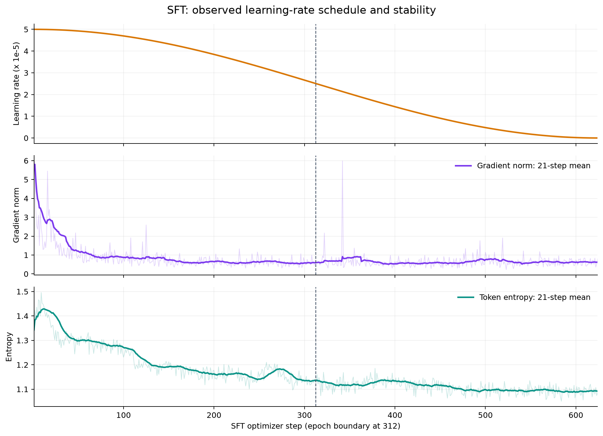
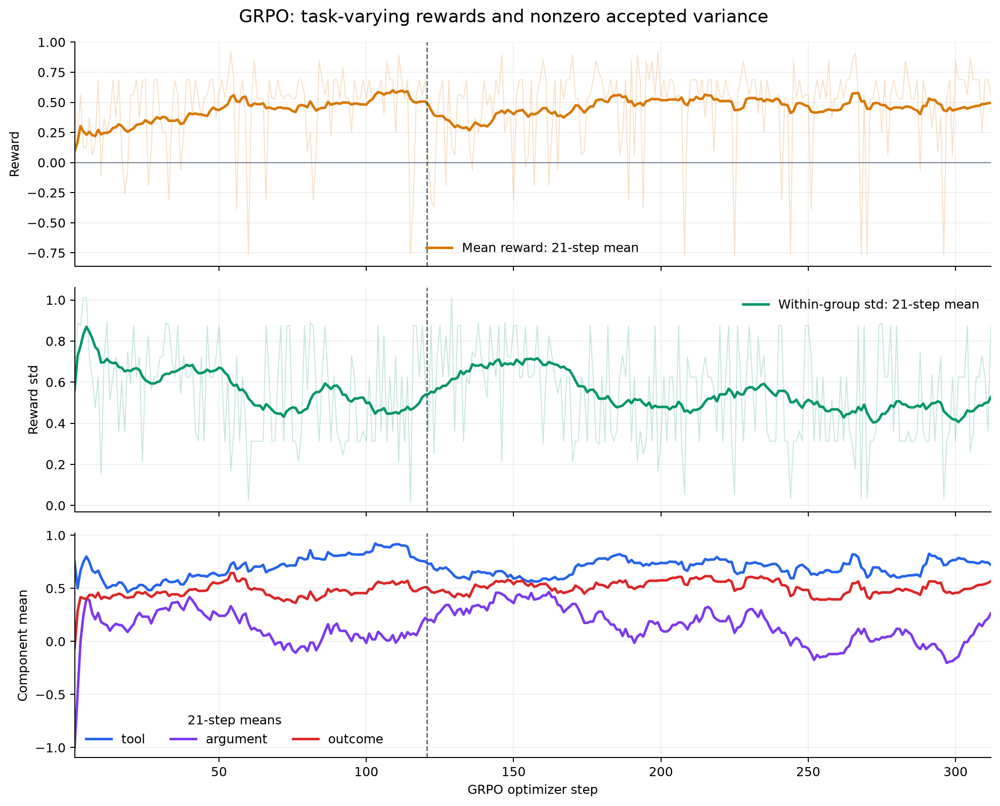
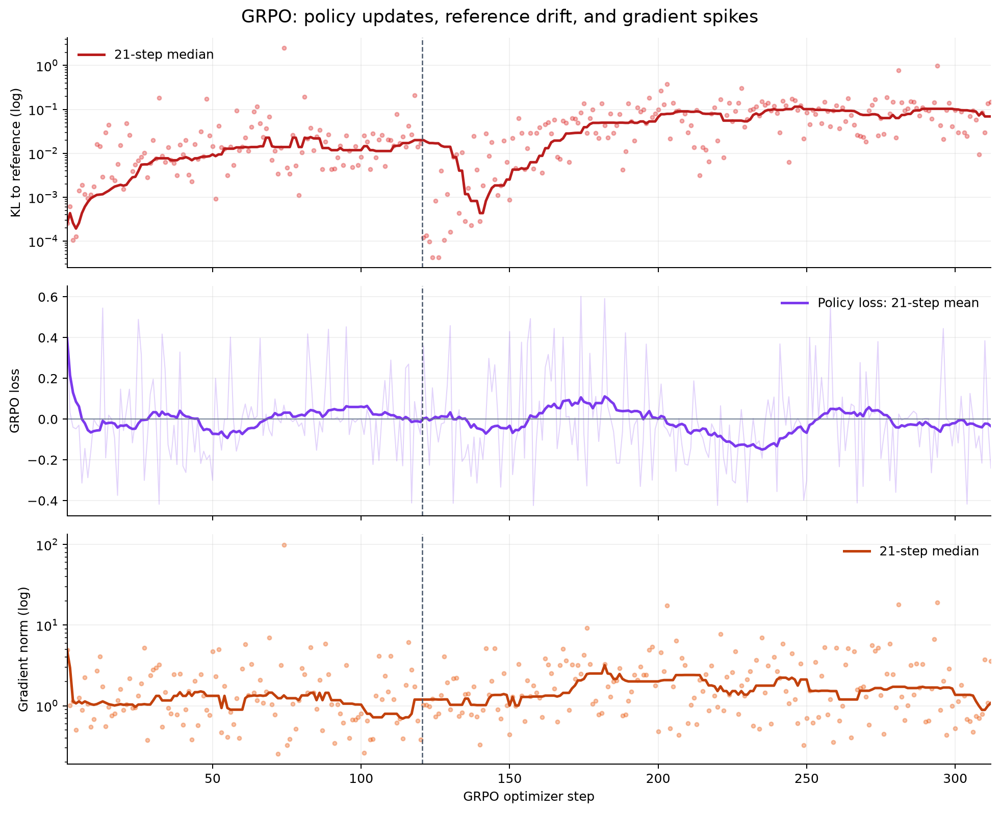
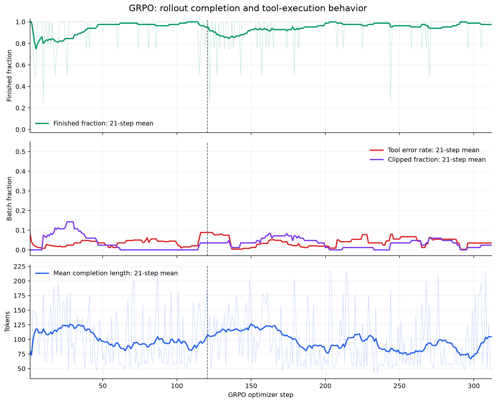
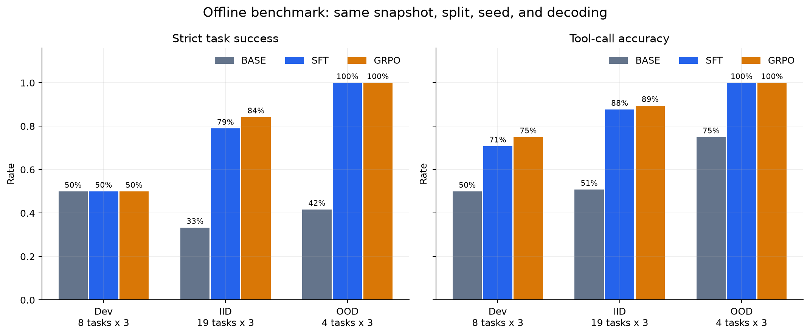

# Qwen3.5-2B SFT → GRPO：训练曲线、留出评测与上游对照

日期：2026-11-18。图像由 TensorBoard event 原始标量绘制；所有数字来自本地训练 manifest、`trainer_state.json` 和九份离线评测 `summary.json`。本文的“严格成功”指任务结果通过 benchmark 的 strict 判定，训练时的 `rollout/finished` 只表示轨迹终止。

## 实验与证据

| 阶段 | 输入与训练 | 环境 | 核验结果 |
|---|---|---|---|
| SFT | Qwen3.5-2B；旧版 `sft_v4_multiturn_6144.jsonl`，2,496 行、1,032 条链；BF16 LoRA，2 epoch | 魔塔 A10 24GB | 624 步，最终训练均值 loss 0.0816，adapter 已更新；A10 峰值显存 19.1 GiB |
| GRPO | 以上 SFT adapter；39 个 `rl_train` 任务，4 个 generation/prompt，`lr=5e-6`，`reward_curriculum_steps=0`；4090 BF16 LoRA | 4090 24GB | 从 checkpoint-120 恢复后完成 312 步，adapter 已更新；峰值显存 16.4 GiB |
| 评测 | Base / SFT / GRPO，共用 Snapshot、`v7_86` 切分、seed 42、每任务 3 次、离线 regex agent |  | dev 8、IID 19、OOD 4 个任务，共 31 个留出任务、每模型 93 次运行；九份汇总均为 0 执行错误 |

GRPO 是**常规 GRPO 目标 + 动态采样**：manifest 中 `dapo=false`、`loss_type=null`、`beta=0.04`。训练使用当时仓库的规则奖励实现：Format/Tool/Argument/Process/Outcome 权重为 `1:3:2:1:3`，`result_quality`、`efficiency` 作为诊断分量且可触发严重失败的奖励上限；没有自定义权重配置。`reward_curriculum_steps=0` 表示全程使用完整权重。动态采样仅接受组内奖励标准差大于零的组，**不改奖励公式**。第一次运行在第 121 步耗尽 32 次重采样预算；从第 120 步 checkpoint 以 64 次预算恢复并完成。两个 TensorBoard event 在第 121 步重叠，图中取恢复运行的记录，并与最终 `trainer_state.json` 的 312 步逐项核对。GRPO 图中的灰色虚线标记恢复点，SFT 图中的虚线标记 epoch 边界。

### 图 1：SFT loss 与 token accuracy

训练批次交叉熵从第 1 步约 1.098 降至第 624 步约 0.0546；前 25 步均值约 0.428，第 2 个 epoch 均值约 0.0541。训练批次 token accuracy 从约 73.2% 升到约 98.0%。起初模型迅速适应专家动作格式及参数表达，随后在同一训练集的第二遍继续拟合，故下降逐渐放缓。这里的 accuracy 是**训练 token** 命中率，不能当成留出任务成功率；较低训练 loss 也不能证明旧 SFT 数据链完整。

### 图 2：SFT 学习率、梯度与熵

实际记录的学习率第 1 步已约为 `5e-5`，随后按余弦形状衰减到接近零。SFT 日志明确提示当前 TRL 忽略了 `warmup_ratio`，因此不能描述为“按预期先 warmup 再下降”。梯度范数早期较高，后期中位数约 0.63，虽有单步尖峰，没有持续上升；token 熵由约 1.34 降至约 1.09，说明训练数据上的预测更集中。熵下降与监督拟合一致，但本身不等于泛化变好。

### 图 3：GRPO 奖励、组内方差与分量

单步奖励起伏很大；前 40 步均值约 0.336，41–120 步约 0.498，201–312 步约 0.488，**不是单调增长**。后段相对前 40 步的均值较高，同时平均组内标准差从约 0.669 降到 0.502。工具、参数、结果分量的曲线也不一致：工具分量前 40 步约 0.555、后段约 0.711；参数分量反而从约 0.262 降到 0.087。每步抽到的任务不同，动态采样又剔除零方差组，所以这些曲线混合了策略变化与任务组合变化；不能仅凭奖励上升断言参数能力提升。非零方差表明被接受的组提供了相对奖励信号，不代表所有 39 个任务始终都有信号。

### 图 4：GRPO KL、policy loss 与梯度

GRPO loss 围绕零上下波动且可为负，与 SFT 交叉熵的绝对值不可比较，也不要求单调下降。KL 的 21 步中位数由前 40 步约 0.006 增至后 112 步约 0.092，说明策略总体上离冻结参考 adapter 更远；恢复后 KL 曾回落，但现有记录不足以把回落归因于参考模型重置。第 74、281、294 步有明显 KL/梯度尖峰，其中第 74 步 KL 约 2.49、梯度范数约 99.5，属于需要关注的局部不稳定点。最终训练仍走完 312 步，参考 adapter 在可核验的后期 checkpoint 与最终目录哈希一致；仅凭这些尖峰不能判定整体发散。KL 和梯度使用对数纵轴以保留极端值。

### 图 5：GRPO rollout 行为

训练组中正常结束比例前 40 步均值约 88.1%、后 112 步约 97.1%；平均 completion 长度由约 116 token 降到 91 token，截断比例由约 8.1% 降到 2.5%。这与更快结束、较少触发长度上限一致，但也可能受任务组合影响。工具错误比例约 3.3%→4.4%，**没有证据表明工具执行错误随训练下降**。尤其 `finished` 包含可能错误的 FINISH，必须用留出集 strict 指标判断任务质量。

### 图 6：同协议留出 Benchmark

| 切分（运行数） | Base strict / tool | SFT strict / tool | GRPO strict / tool | GRPO 相对 SFT strict |
|---|---:|---:|---:|---:|
| dev（24） | 50.0% / 50.0% | 50.0% / 70.8% | 50.0% / 75.0% | 0.0 个百分点 |
| IID（57） | 33.3% / 50.9% | 78.9% / 87.7% | **84.2% / 89.5%** | **+5.3 个百分点** |
| OOD（12） | 41.7% / 75.0% | 100% / 100% | 100% / 100% | 0.0 个百分点 |
| 31 个留出任务合并（每模型 93 次） | 38.7% / 53.8% | 74.2% / 84.9% | **77.4% / 87.1%** | **+3.2 个百分点** |

合并行是按 93 次运行直接汇总：strict 成功分别为 `36/93`、`69/93`、`72/93`；工具准确分别为 `50/93`、`79/93`、`81/93`。因此主要提升来自 SFT（strict +35.5 个百分点）。GRPO 在 IID 多出的 3 次成功全部来自 `ref_stress_learning_state` 这一任务的 3 次运行由失败变为成功；其余留出任务的 strict 比例与 SFT 相同。工具准确在总体多 2 次；dev strict 持平，OOD 已到天花板。GRPO 在 dev 的完成率从 SFT 83.3% 降到 75.0%，不能称为所有指标全面提升。各模型平均 token 数约为 Base 8505、SFT 6982、GRPO 6998；GRPO 与 SFT 的总 token 代价接近。

本次汇总表的 strict 是**逐次运行比例**。若按每任务 3 次都 strict 成功重算，dev 的 Base/SFT/GRPO 为 `2/8=25.0%` / `4/8=50.0%` / `4/8=50.0%`；IID 为 `1/19=5.3%` / `15/19=78.9%` / `16/19=84.2%`；OOD 为 `0/4=0%` / `4/4=100%` / `4/4=100%`。这组数更接近上游标注的 `pass³` 可靠性口径，但仍**不是同一实验**。

## 与 Algorineko 原仓库结果的区别

用户提到的“drpo”需要区分：上游 README 的主流程是 **SFT → DPO → GRPO**；另有 **Dr.GRPO** 作为 GRPO loss 变体。我们的实验只训练了 SFT → GRPO，没有训练 DPO 或 Dr.GRPO，不能把动态采样当作 Dr.GRPO。以下只引用上游公开仓库所报告的数值。

| 路线 | 上游已报告的结果 | 我们的对应观察 | 解读 |
|---|---|---|---|
| Qwen2.5-1.5B SFT→GRPO | 上游 `pass³`：dev `0→37.5%`、IID `5.6→44.4%`、OOD `0→50.0%`；训练池从 33 个有信号任务选择，公开结果见 [README 训练阶段](https://github.com/Algorineko/AgenticArXiv-RL/blob/main/README.md#%EF%B8%8F-%E8%AE%AD%E7%BB%83%E8%B7%AF%E5%BE%84sft--dpo--grpo--opd) | Qwen3.5-2B 的逐任务三次全成功：dev `50.0→50.0%`、IID `78.9→84.2%`、OOD `100→100%` | 两条路线均在各自 IID 上有提升，但我们的 GRPO 增量小，dev 无 strict 增量，OOD 已饱和；不能直接比较 84.2% 与 44.4% 的高低。 |
| 上游 Dr.GRPO 变体 | Qwen2.5-1.5B、60 步、同一 33 任务池；相对上游常规 GRPO，`rl_train` `63.6→65.7%`，dev/IID/OOD 均持平；见 [范式对比](https://github.com/Algorineko/AgenticArXiv-RL/blob/main/docs/rl_paradigm_comparison.md) | 我们的 manifest 是常规 GRPO 目标、312 步、39 训练任务，没有 Dr.GRPO 对照臂 | 上游 Dr.GRPO 的收益是小幅训练池差异，不支持推断我们改用 Dr.GRPO 必然更好。 |
| 上游 Qwen3-VL-8B SFT→DPO→GRPO | 81 任务 greedy：Base strict 24.7%、SFT 66.7%、DPO 65.4%、GRPO 72.8%；SFT→GRPO +6.1 个百分点；见 [端侧 VLM 实验](https://github.com/Algorineko/AgenticArXiv-RL/blob/main/docs/edge-vlm-posttrain.md) | 我们是 Qwen3.5-2B 文本策略、31 个留出任务、每任务重复 3 次；合并 strict `38.7→74.2→77.4%` | 上游 8B 路线包含 DPO、图像与质量任务，模型、评测集和解码协议均不同；只能比较“增量主要来自 SFT，GRPO 带来较小额外收益”这一实验内趋势。 |

此外，上游 Qwen2.5-1.5B 的 SFT 是 2,628 条专家轨迹的**全参数**训练，而我们是旧版 2,496 行多轮数据上的 **LoRA**；上游 60 步范式对照关闭动态采样、使用单卡 64 GB DCU，我们在 4090 上跑 312 步并启用动态采样。[README](https://github.com/Algorineko/AgenticArXiv-RL/blob/main/README.md) 与[范式对比实验设置](https://github.com/Algorineko/AgenticArXiv-RL/blob/main/docs/rl_paradigm_comparison.md)给出了这些差异。上游表中 `pass³` 是其公开标签；由于原始逐条运行数据未在本地核对，这里不重新解释其计算公式。模型规模、训练数据、任务切分、Snapshot、采样/解码和统计口径同时变化，跨项目的绝对百分比没有可归因性。

## 结论与限制

当前证据支持：旧 SFT adapter **可用且显著优于本次 Base**；GRPO 完成了真实参数更新，并在 IID strict 有小幅增益，dev strict 持平，OOD 被 4 个任务的 100% 成绩封顶。训练曲线说明优化在进行，**留出 Benchmark 才是效果证据**。旧版 SFT 数据先前暴露 setup/截断统计问题，本报告没有完成逐链审计；因此结果属于“旧数据配方”的实测，不能称为已修复数据上的正式复现。单种子、31 个留出任务、OOD 仅 4 个任务也限制了稳健性推断；离线 Snapshot 成绩不等于在线 arXiv 成绩。

## 图像来源与文件位置

- 六张图由本地 TensorBoard event 文件生成。源文件 SHA256、步数和恢复去重规则见[`source_manifest.json`](figures/qwen35_training_20261118/source_manifest.json)；原始日志与训练数据不在本次发布内容中。
- 原始评测汇总：`outputs/qwen35_grpo_export_20261118/eval_results/qwen35_base_sft_grpo_4090_20261117_posttrain/`；SFT manifest/log 位于仓库上一级 `qwen35_sft_full_e2/`；GRPO manifest/log 位于 `outputs/qwen35_grpo_export_20261118/outputs/qwen35_grpo_4090_20261117_221756/`。
